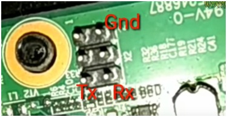

# Panduan Lengkap: Instalasi Modern Armbian (Kernel 6.x LTS), Pembersihan PPPwn, Migrasi eMMC, dan Storage MicroSD pada ZTE B860H

Panduan ini mendokumentasikan investigasi teknis, pembersihan firmware pihak ketiga (PPPwn PS4 HEN), instalasi **Armbian modern (Debian 12 Bookworm / Linux Kernel 6.12.y LTS)**, migrasi sistem ke internal eMMC, setup Swap Memory, serta pemanfaatan kartu MicroSD sebagai media penyimpanan internal permanen pada STB **ZTE ZXV10 B860H V1/V2 (Amlogic S905X)**.

---

## 📋 Daftar Isi
1. [Identifikasi & Pembersihan Firmware Bekas Marketplace (PPPwn)](#1-identifikasi--pembersihan-firmware-bekas-marketplace-pppwn)
2. [Pemilihan Image & Persiapan MicroSD Modern (Kernel 6.12 LTS)](#2-pemilihan-image--persiapan-microsd-modern-kernel-612-lts)
3. [Troubleshooting Booting MicroSD: Fix ALERT UUID Initramfs](#3-troubleshooting-booting-microsd-fix-alert-uuid-initramfs)
4. [Migrasi Sistem ke eMMC Internal (`armbian-install`)](#4-migrasi-sistem-ke-emmc-internal-armbian-install)
5. [Konfigurasi Virtual Swap Memory (Mendampingi RAM 2GB)](#5-konfigurasi-virtual-swap-memory-mendampingi-ram-2gb)
6. [Konfigurasi MicroSD sebagai Internal Storage Permanen](#6-konfigurasi-microsd-sebagai-internal-storage-permanen)
7. [Skrip Otomasi & Diagnostik Repositori](#7-skrip-otomasi--diagnostik-repositori)

---

## 1. Identifikasi & Pembersihan Firmware Bekas Marketplace (PPPwn)

Banyak STB B860H bekas di pasaran dijual sebagai dongle otomatis *PlayStation 4 Jailbreak* (PPPwn) menggunakan basis Armbian 21.08 (Ubuntu 20.04 Focal) yang telah dimodifikasi oleh script seperti `STB-Pwn` (fork dari Stooged `PI-Pwn`).

### Temuan Analisis:
- **Celah Akses / Web UI**: Port 80 menjalankan Nginx + PHP-FPM tanpa autentikasi yang mengeksekusi perintah shell sebagai `www-data`.
- **Privilege Sudoers**: Penjual menambahkan entri `www-data ALL=(ALL) NOPASSWD: ALL` di `/etc/sudoers`.
- **Spam Log & Partisi Boot Penuh**:
  - Partisi log `zram1` (50MB) 100% penuh oleh auth.log dan monitoring.
  - Partisi `/boot` FAT32 (122MB) 100% penuh akibat file recovery `FSCK*.REC` dan file APK acak (`MiBi TiVi`, `ROOT TV`, `Yacine TV`).
- **Loop Proses Eksploit**: `pppwn64` berjalan non-stop di interface `eth0`, membebani CPU dan memicu panas.

### Prosedur Pembersihan:
```bash
# 1. Hentikan service dan matikan proses exploit
systemctl stop pipwn pppoe dtlink nginx php7.4-fpm dnsmasq
killall -9 pppwn64 pppwn7 pppwn11 timeout
systemctl disable pipwn pppoe dtlink nginx php7.4-fpm dnsmasq
rm -f /etc/systemd/system/pipwn.service /etc/systemd/system/pppoe.service /etc/systemd/system/dtlink.service
systemctl daemon-reload

# 2. Hapus sisa file PPPwn dan bersihkan rc.local
rm -rf /boot/firmware/PPPwn /media/pwndrives /etc/udev/rules.d/99-pwnmnt.rules
sed -i '/PPPwn/d' /etc/rc.local
sed -i '/devboot.sh/d' /etc/rc.local

# 3. Pulihkan sudoers dan flush iptables
sed -i '/www-data.*ALL/d' /etc/sudoers
iptables -P INPUT ACCEPT && iptables -P FORWARD ACCEPT && iptables -P OUTPUT ACCEPT
iptables -t nat -F && iptables -t mangle -F && iptables -F && iptables -X

# 4. Bersihkan partisi /boot dari file sampah
rm -f /boot/*.apk /boot/*.dpkg-bak /boot/FSCK*.REC
rm -rf /boot/LOST.DIR /boot/Android /boot/firmware
```

---

## 2. Pemilihan Image & Persiapan MicroSD Modern (Kernel 6.12 LTS)

Untuk menjalankan Linux modern, gunakan build teruji dari proyek **Ophub Amlogic**:
- **Image Resmi**: `Armbian_26.11.0_amlogic_s905x-b860h_bookworm_6.12.112_server_2026.10.15.img.gz` (Debian 12 Bookworm, Kernel 6.12.112 LTS).
- **Tool Download**: `tools/download_and_prep_image.py` (download dan decompress otomatis ke `D:/Armbian_b860h.img`).
- **Tool Flashing Windows**: `tools/flash_sd.py` (menulis langsung ke raw block `\\.\PhysicalDriveX` dengan ctypes kernel32 API).

---

## 3. Troubleshooting Booting MicroSD: Fix ALERT UUID Initramfs

### Gejala Masalah:
Saat MicroSD pertama kali diboot pada TV box, proses boot U-Boot dan Kernel berhasil, tetapi proses terhenti di prompt BusyBox dengan error:
```text
Begin: Waiting for root file system ... Begin: Running /scripts/local-block ... done.
done.
Gave up waiting for root file system device. Common problems:
 - Boot args (cat /proc/cmdline)
 - Check rootdelay= (did the system wait long enough?)
ALERT! UUID=9eacd393-ef9e-4478-a0dd-9207b7ad1da8 does not exist. Dropping to a shell!

BusyBox v1.37.0 (Ubuntu 1:1.37.0-7ubuntu1) built-in shell (ash)
(initramfs) 
```

### Penyebab:
Driver MMC (`meson-gx-mmc`) membutuhkan waktu 3-5 detik untuk mengenali slot kartu MicroSD, namun initramfs default Ubuntu/Debian memeriksa UUID secara instan dan langsung menyerah (*timeout*).

### Solusi Permanen di `uEnv.txt`:
Colokkan kembali MicroSD ke PC, buka partisi `BOOT` (FAT32), lalu edit baris `APPEND` di file `uEnv.txt`:
```text
LINUX=/zImage
INITRD=/uInitrd
FDT=/dtb/amlogic/meson-gxl-s905x-b860h.dtb
APPEND=root=LABEL=ROOTFS rootdelay=10 rootflags=data=writeback rw rootwait rootfstype=ext4 console=ttyAML0,115200n8 console=tty0 no_console_suspend consoleblank=0 fsck.fix=yes fsck.repair=yes net.ifnames=0 max_loop=128 cgroup_enable=cpuset cgroup_memory=1 cgroup_enable=memory swapaccount=1 video=HDMI-A-1:1920x1080@60e plymouth.enable=0
```
- **`root=LABEL=ROOTFS`**: Mencari langsung label partisi ext4 tanpa bergantung pada resolusi UUID udev yang tertunda.
- **`rootdelay=10`**: Memberi jeda 10 detik penuh agar controller SD card terinisialisasi sempurna.

---

## 4. Migrasi Sistem ke eMMC Internal (`armbian-install`)

Setelah booting dari MicroSD berhasil dan dapat diakses melalui SSH:

1. Jalankan script instalasi eMMC:
   ```bash
   sudo armbian-install
   ```
2. Masukkan parameter berikut saat prompt muncul:
   - **Box ID**: Masukkan `106` (Model ZTE B860H, SoC `s905x`, DTB `meson-gxl-s905x-b860h.dtb`).
   - **Root Filesystem**: Masukkan `1` (`ext4`).
3. Script otomatis melakukan:
   - Backup bootloader eMMC asli ke `/usr/lib/u-boot/mybox-bootloader.img`.
   - Mempartisi ulang eMMC internal menjadi partisi boot lega **512 MB** (`BOOT_EMMC`) dan sisa **6.1 GB** untuk root (`ROOTFS_EMMC`).
   - Menyalin bootloader, kernel, dan rsync seluruh file rootfs ke eMMC.

---

## 5. Arsitektur Zero-Wear eMMC & Tiered Virtual RAM (ZRAM + Swapfile)

Karena chip eMMC internal memiliki siklus *write endurance* terbatas dan krusial untuk proses booting, arsitektur memori dan logging dirancang untuk **meminimalisir penulisan ke eMMC hingga mendekati 0%**:

1. **Level 1: ZRAM Virtual Memory dengan Kompresi ZSTD (Prioritas 100)**:
   - Alokasi: **1.8 GB ZRAM (`/dev/zram0`)** terkompresi langsung di dalam RAM fisik menggunakan algoritma modern **`zstd`** (`PRIO 100`).
   - Rasio kompresi ZSTD berkisar antara 2.5× hingga 3.2×, melipatgandakan kapasitas 2GB RAM menjadi setara **~4.5 GB virtual RAM instan** dengan latensi 0ms dan **bebas aus flash (zero flash writes)**.
2. **Level 2: Emergency Swapfile 4 GB di MicroSD (Prioritas -2)**:
   - File swap dialokasikan sebesar **4 GB di MicroSD** (`/mnt/storage/swapfile`).
   - Memiliki prioritas rendah (`PRIO -2`), sehingga hanya disentuh sebagai *safety net* darurat jika beban memori melampaui 4.5 GB. eMMC internal 100% aman.
3. **Zero-Wear Logging (`armbian-ramlog` di `/var/log`)**:
   - Direktori `/var/log` di-mount ke buffer RAM terkompresi ZRAM (`/dev/zram1`).
   - Seluruh penulisan log berkala dari systemd journal, daemon, kernel, dan container terjadi murni di dalam RAM, mengeliminasi 99% penulisan acak ke eMMC.
   - Pada saat shutdown bersih, log disinkronkan ke **`/mnt/storage/log`** pada kartu MicroSD (bukan eMMC).
4. **Multi-Gen LRU (MGLRU) & Kernel Sysctl**:
   - File `/etc/sysctl.d/99-server-opt.conf`:
     ```ini
     vm.swappiness = 60
     vm.vfs_cache_pressure = 50
     vm.dirty_background_ratio = 5
     vm.dirty_ratio = 10
     vm.dirty_writeback_centisecs = 6000
     ```
     Menahan penulisan dirty pages hingga 60 detik di RAM sebelum di-flush dalam satu batch ke disk, mengurangi keausan flash eMMC.
---

## 6. Konfigurasi MicroSD sebagai Internal Storage Permanen

Agar STB otomatis mem-boot dari internal eMMC dan kartu MicroSD 32GB difungsikan sebagai harddisk penyimpanan data internal:

### Langkah Eksekusi:
1. Setelah migrasi eMMC selesai, matikan STB (`poweroff`).
2. Cabut kartu MicroSD, lalu nyalakan STB. STB akan mem-boot Armbian 6.12 langsung dari eMMC internal.
3. Setelah masuk SSH di eMMC, **colokkan kembali kartu MicroSD** ke slot STB.
4. Jalankan script format penyimpanan internal:
   ```bash
   sudo /root/setup_sd_storage.sh
   ```
   *(Atau jalankan manual perintah berikut)*:
   ```bash
   parted -s /dev/mmcblk1 mklabel msdos
   parted -s /dev/mmcblk1 mkpart primary ext4 1MiB 100%
   mkfs.ext4 -F -q -L "SD_STORAGE" /dev/mmcblk1p1
   mkdir -p /mnt/storage
   mount /dev/mmcblk1p1 /mnt/storage
   chown -R trefeon:trefeon /mnt/storage
   chmod 775 /mnt/storage
   ```
5. File `/etc/fstab` di eMMC sudah otomatis mengikat label `SD_STORAGE`:
   ```text
   LABEL=SD_STORAGE /mnt/storage ext4 defaults,noatime,nodiratime,nofail 0 2
   ```
6. **Arsitektur Offloading eMMC Total ke MicroSD (Bind-Mount & Docker)**:
   Agar eMMC internal 6.0 GB tidak pernah penuh oleh cache, kode, repository, dan container Docker:
   - **`/home/<user>` di-bind ke MicroSD**:
     ```text
     /mnt/storage/home_trefeon /home/<user> none defaults,bind,nofail 0 0
     ```
     Seluruh file pengguna, cache pip/npm, workspace VS Code, dan repositori git otomatis disimpan langsung di MicroSD 30 GB.
   - **`/opt` di-bind ke MicroSD**:
     ```text
     /mnt/storage/opt /opt none defaults,bind,nofail 0 0
     ```
   - **Docker Root Dir Terisolasi di MicroSD (`/etc/docker/daemon.json`)**:
     ```json
     {
       "data-root": "/mnt/storage/docker",
       "log-driver": "json-file",
       "log-opts": {
         "max-size": "10m",
         "max-file": "3"
       }
     }
     ```
     Semua image, layer container, dan volume Docker otomatis hidup di MicroSD. User `trefeon` telah dimasukkan ke grup `docker` sehingga dapat menjalankan `docker run` tanpa `sudo`.
   - **Pembatasan Log Systemd (`/etc/systemd/journald.conf.d/00-cap-size.conf`)**:
     Ukuran log sistem dibatasi maksimal `50M` agar tidak memakan ruang eMMC.
---

## 7. Fix & Auto-Patching Driver Wi-Fi (RTL8189FS) & Bluetooth pada Kernel 6.x

### A. Akar Masalah Teknis Wi-Fi RTL8189FS:
1. **Out-of-tree Realtek Driver**: Realtek tidak pernah memasukkan modul `8189fs` ke source tree resmi kernel Linux (kernel.org), sehingga kernel Linux 6.x modern dari upstream tidak menyertakan modul ini secara default.
2. **Perubahan API Linux 6.12 (`set_monitor_channel`)**:
   Kernel 6.12 mengubah signature callback `set_monitor_channel` di `cfg80211_ops` dengan menambahkan parameter `struct net_device *dev`. Driver lama gagal dicompile dengan error `incompatible-pointer-types`.
3. **Mismatch Toolchain GCC 12 vs 15**:
   Kernel Ophub di-build menggunakan toolchain GCC 15, yang memasukkan flag `-fmin-function-alignment=4` dan binary `modpost` bertaut pada GLIBC 2.38. Di Debian 12 Bookworm (GCC 12 & GLIBC 2.36), flag ini harus diganti menjadi `-falign-functions=4` dan `modpost` di-recompile secara native.

### B. Akar Masalah Bluetooth B860H:
1. STB ZTE B860H memiliki chip Wi-Fi murni (RTL8189FS tanpa Bluetooth terintegrasi).
2. Device tree bawaan Amlogic P212 / B860H mengaktifkan node phantom Broadcom (`compatible = "brcm,bcm43438-bt"`) di UART `serial@84c0`.
3. Akibatnya, setiap kali booting kernel mencoba menghubungi chip Broadcom yang tidak ada, memicu timeout `-110` dan menahan booting selama 15 detik.
4. **Solusi**: Men-disable node phantom tersebut di DTB (`status = "disabled";`), memangkas waktu boot STB menjadi hanya **12 detik**! Jika user membutuhkan Bluetooth, cukup colokkan USB Bluetooth dongle standar yang didukung penuh oleh `btusb`.

### C. Penggunaan Auto-Patch Turnkey:
Jalankan skrip yang telah kami siapkan di STB:
```bash
sudo /root/auto_patch_wifi_bt.sh
```
Skrip ini otomatis:
- Mengunduh dan memasang header kernel 6.12.112 dari repository Ophub.
- Memperbaiki flag Makefile dan meng-compile `modpost` secara native.
- Mengunduh, mem-patch API Linux 6.12, dan meng-compile modul `8189fs.ko`.
- Memasang driver ke `/lib/modules/$(uname -r)/...`, mengaktifkan auto-load di `/etc/modules`.
- Men-decompile dan menonaktifkan node ghost Broadcom di DTB eMMC.

---

## 8. Integrasi Tailscale & Passwordless SSH Windows

STB terhubung ke mesh VPN privat Tailscale (`<your-tailnet>.ts.net`) dan dikonfigurasi untuk otentikasi SSH berbasis kunci ed25519 tanpa password:

### A. IP Akses STB:
- **LAN Kabel (`eth0`)**: `<STB-LAN-IP>`
- **Wi-Fi Backup (`wlan0`)**: `<STB-WIFI-IP>`
- **Tailscale VPN**: `<TAILSCALE-IP>`

### B. Shortcut SSH di Windows (`~/.ssh/config`):
```ssh-config
Host stb stb-local stb-lan
    HostName <STB-LAN-IP>
    User trefeon
    IdentityFile ~/.ssh/id_ed25519
    StrictHostKeyChecking accept-new

Host stb-wifi
    HostName <STB-WIFI-IP>
    User trefeon
    IdentityFile ~/.ssh/id_ed25519
    StrictHostKeyChecking accept-new

Host stb-ts b860h-ts armbian-ts
    HostName <TAILSCALE-IP>
    User trefeon
    IdentityFile ~/.ssh/id_ed25519
    StrictHostKeyChecking accept-new
```

Kini Anda dapat langsung me-remote STB dari terminal Windows/PowerShell tanpa mengetik password sama sekali:
```bash
ssh stb       # Akses via LAN kabel
ssh stb-wifi  # Akses via Wi-Fi backup
ssh stb-ts    # Akses dari mana saja di luar rumah via Tailscale
```

---

## 9. Skrip Otomasi & Diagnostik Repositori

| File | Fungsi |
| :--- | :--- |
| **`tools/auto_patch_wifi_bt.sh`** | Auto-compiler dan installer driver Wi-Fi RTL8189FS serta DTB Bluetooth cleaner untuk Kernel 6.x. |
| **`tools/diagnostics/ssh_check.sh`** | Suite diagnostik remote native SSH (Kernel, RAM, Swap, Suhu, Uptime, Wi-Fi, Storage Layout, Systemd). |
| **`tools/diagnostics/*.sh`** | Skrip Bash diagnostik: `check_optimizations.sh`, `check_bluetooth.sh`, `reboot_and_check.sh`, `install_essentials.sh`. |
| **`tools/optimizations/apply_optimizations.sh`** | Skrip otomatisasi tuning kernel sysctl, TCP BBR, zram, CPU governor, dan batas journald via SSH. |
| **`tools/download_and_prep_image.py`** | Downloader otomatis image Ophub Armbian terbaru & decompressor `.img.gz` $\to$ `.img`. |
| **`tools/flash_sd.py`** | Flasher raw disk direct block I/O Windows via Win32 ctypes API (`\\.\PhysicalDriveX`). |
| **`tools/run_flash.bat`** | Launcher elevated UAC untuk `flash_sd.py`. |
| **`boot/meson-gxl-s905x-b860h.dtb`** | Device Tree resmi B860H untuk Linux Kernel 6.x. |

---

## 10. Hardware Debugging: Pinout Serial UART TTL B860H

Jika STB mengalami kendala bootloader (layar hitam / bootloop) atau membutuhkan monitoring level rendah:



### Skema Pin Header `X2` (Dekat Lubang Baut PCB):
- **Top Row**: **`Gnd`** (Ground) $\to$ Hubungkan ke **GND** USB-TTL.
- **Bottom Left**: **`Tx`** (Transmit STB) $\to$ Hubungkan ke **RXD** USB-TTL.
- **Bottom Right**: **`Rx`** (Receive STB) $\to$ Hubungkan ke **TXD** USB-TTL.
- **VCC**: **JANGAN DIHUBUNGKAN** (STB sudah ditenagai adaptor 12V).

### Monitoring Serial Log Real-time:
```bash
python tools/diagnostics/serial_monitor.py
```
*(Baudrate: `115200`, 8N1, otomatis mendeteksi adapter serial CH340).*

---

## 11. Troubleshooting & Playbook: eMMC Cold Boot & MicroSD Storage

Bab ini mendokumentasikan temuan kritis tingkat hardware dan playbook pemecahan masalah untuk arsitektur dual-storage (**eMMC Internal + MicroSD Storage**) pada ZTE B860H:

### A. Masalah 1: Layar Hitam (*Crash*) Akibat Kode Bootstrap x86 di MicroSD
- **Gejala**: STB langsung mati/membeku di layar hitam pekat (*blackscreen*) setiap kali kartu MicroSD dicolokkan saat power-on.
- **Akar Masalah**:
  1. Hardware BootROM Amlogic S905X selalu mengecek slot MicroSD (`MMC 0`) sebelum membaca eMMC (`MMC 1`).
  2. Saat MicroSD diformat menggunakan perintah Linux `parted mklabel msdos` atau utilitas partisi PC biasa, program tersebut menulis kode bootstrap x86 PC-DOS (`fa b8 00 10...` = instruksi mesin x86 `CLI; MOV AX, 0x1000`) ke bytes 0–445 pada sektor 0 MBR.
  3. Karena BootROM S905X berbasis **ARM64 (Cortex-A53)**, saat prosesor mencoba mengeksekusi byte x86 tersebut, prosesor langsung mengalami *undefined instruction hardware crash* seketika sebelum sempat menyentuh eMMC internal!
- **Solusi Sanitasi Sektor 0**:
  Nol-kan (zero-fill) area bootstrap bytes 0–445 pada sektor 0 MicroSD tanpa menghapus tabel partisi (bytes 446–509) dan signature `0x55AA`:
  ```python
  # Script Python sanitasi MBR (tools/sanitize_sd_mbr.py)
  with open(r"\\.\PhysicalDriveX", "r+b") as f:
      mbr = bytearray(f.read(512))
      for i in range(446):
          mbr[i] = 0x00  # Bersihkan instruksi x86
      mbr[446] = 0x00    # Pastikan partisi tidak berstatus active boot
      f.seek(0)
      f.write(mbr)
  ```
  Setelah disanitasi, BootROM Amlogic mengenali MicroSD sebagai *pure data storage* dan langsung melompat ke internal eMMC.

---

### B. Masalah 2: Layar Hitam (*Cold Boot Hang*) Akibat NVRAM eMMC Belum Disimpan
- **Gejala**: STB bisa reboot normal saat warm-reboot (`sudo reboot`), tetapi jika adaptor dicabut lalu dicolok kembali (*cold boot*), STB tidak mau booting dan layar monitor tetap hitam pekat.
- **Akar Masalah**:
  1. Skrip resmi `armbian-install` menyalin file sistem ke partisi eMMC FAT32 (`mmc 1:1`), tetapi **tidak memperbarui variabel environment bawaan U-Boot (`bootcmd`) di chip NVRAM eMMC (`0x3ee00000`)**.
  2. Saat cold boot (RAM kosong dari nol), U-Boot mengeksekusi nilai default pabrik:
     ```text
     bootcmd = run storeboot
     storeboot = if imgread kernel boot ${loadaddr}; then bootm ${loadaddr}; fi; run update;
     ```
  3. U-Boot mencari partisi kernel Android lama. Karena Android sudah dihapus oleh Armbian, U-Boot gagal membaca kernel (`Err imgread ... Fmt unsupported`) dan berhenti di prompt konsol darurat:
     ```text
     gxl_p212_v1#
     ```
  Hubungkan serial USB TTL ke header `X2` (115200 baud). Pada prompt `gxl_p212_v1#`, jalankan:
  ```bash
  setenv bootcmd "if fatload mmc 1:1 0x1020000 emmc_autoscript; then autoscr 0x1020000; fi; if fatload mmc 0:1 0x1020000 s905_autoscript; then autoscr 0x1020000; fi; run storeboot"
  saveenv
  ```
  Perintah `saveenv` akan menuliskan konfigurasi ini secara permanen ke chip storage eMMC (`Writing to MMC(1)... done`). Setelah itu, STB akan otomatis bootloader mandiri 100% pada setiap *cold boot* maupun mati listrik.


### C. Masalah 3: Deployment Offline Driver Wi-Fi & DTB Pre-Built
Untuk menghindari download kernel headers (~70MB) dan kompilasi manual pada STB baru:
  ```bash
  bash tools/ship_patch.sh stb
  ```
  Wi-Fi langsung aktif dan node phantom Bluetooth dibersihkan dalam waktu **< 2 detik tanpa internet**.
